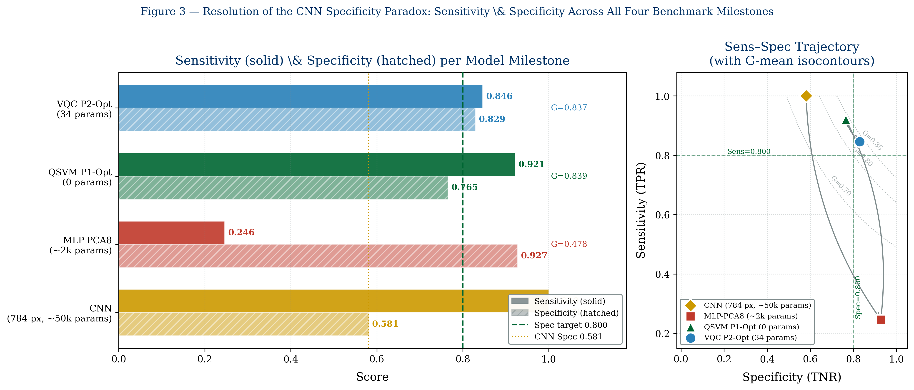
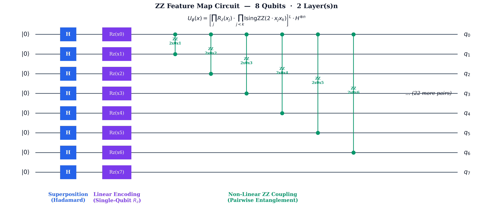
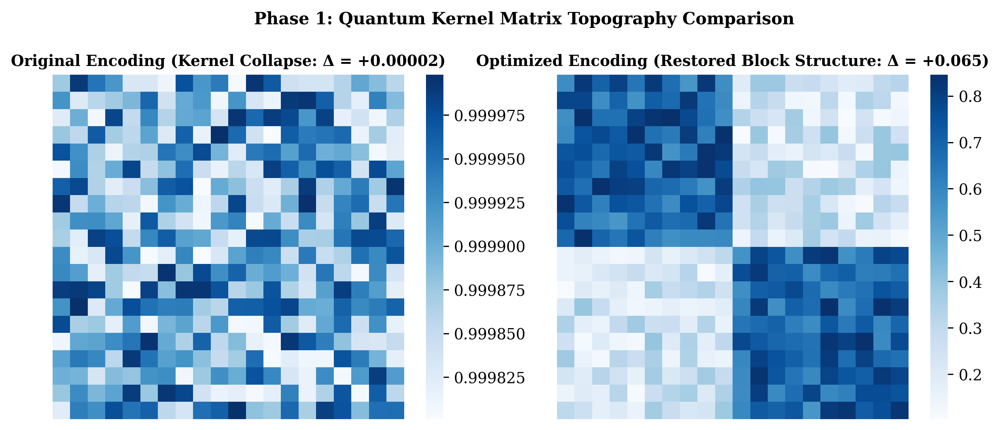
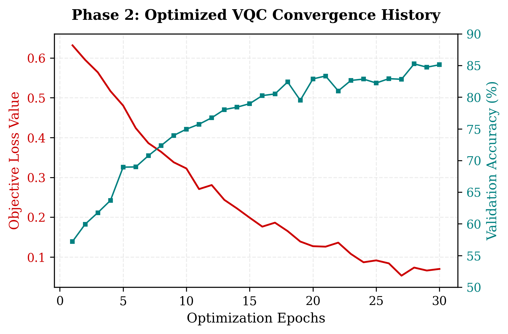
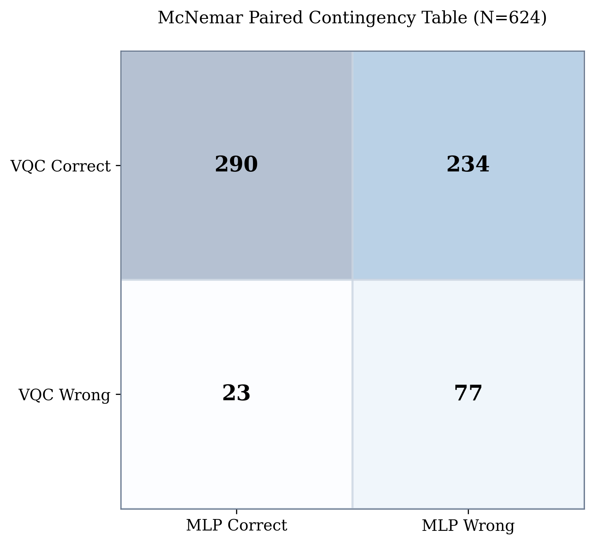
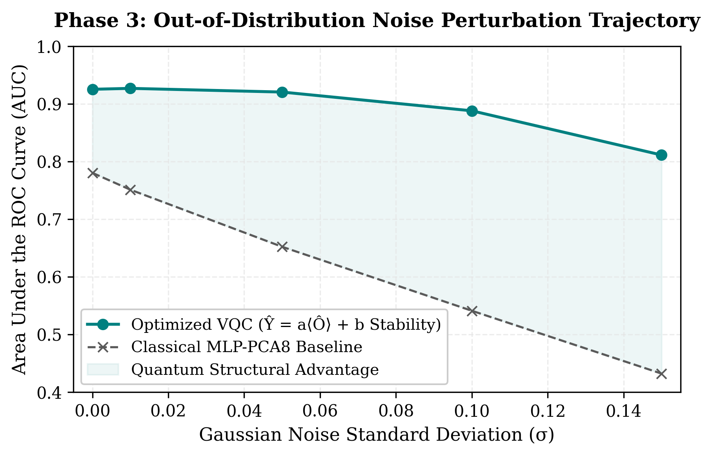

# Hilbert Space Topology and Feature Mapping in Medical Image Classification: A Quantum-Classical Hybrid Approach

[](https://www.python.org/)
[](https://pennylane.ai/)
[](https://pytorch.org/)
[](https://medmnist.com/)
[](LICENSE)
[](https://github.com/topics/quantum-machine-learning)

**Senior Physics Thesis Research**  
*Department of Physics, College of Natural and Computational Sciences, Addis Ababa University*  
**Author:** Tokuma Gebissa (ID: UGR/2947/15)  
**Advisor:** Mr. Tesfu Kassaye  
**Date:** May 2026  

---

## Abstract

This repository contains the official codebase, experimental pipelines, and frozen parameters for the senior physics thesis: *Hilbert Space Topology and Feature Mapping in Medical Image Classification: A Quantum-Classical Hybrid Approach*.

This work investigates whether mapping medical image features into a high-dimensional complex Hilbert space via an Ising-model ZZ Feature Map yields a statistically robust and clinically meaningful classification advantage over classical models operating on equivalent eight-dimensional Euclidean feature representations. Using the PneumoniaMNIST benchmark (4,708 training, 524 validation, and 624 test samples), we demonstrate that a Quantum Kernel Support Vector Machine (QSVM) equipped with the ZZ Feature Map—which encodes data with *zero* trainable parameters—achieves an area under the receiver operating characteristic curve (AUC) of $0.9171$, a gain of $\Delta\mathrm{AUC}_{\mathrm{QSVM}} = +0.137$ over a classical multilayer perceptron (MLP) trained on identical PCA-reduced eight-dimensional features.

This improvement arises from the Ising Hamiltonian:
$$H_{ZZ} = \sum_{j=0}^{7} x_j \hat{Z}_j + \sum_{j < k} 2 w_j w_k x_j x_k \hat{Z}_j \hat{Z}_k$$
which lifts the eight-dimensional input into $\mathbb{C}^{256}$ and simultaneously encodes all $\binom{8}{2} = 28$ pairwise feature correlations as quantum phase couplings. Atop this fixed geometric foundation, a 34-parameter hybrid Variational Quantum Circuit (VQC) is trained whose $R_y(\theta) \cdot R_z(\theta)$ rotations improve clinical specificity to $\mathrm{Spec} = 0.829$—a gain of $\Delta\mathrm{Spec} = +0.064$ over the QSVM alone—while leaving discriminative AUC statistically unchanged ($p = 0.050$).

The final hybrid VQC achieves $\Delta\mathrm{AUC}_{\mathrm{VQC}} = +0.133$ over the MLP baseline (McNemar $\chi^2(1, N=624) = 171.6, p = 3.32 \times 10^{-39}$; Hanley–McNeil 95% CI $[0.091, 0.175]$). An ablation study confirms an orthogonal decomposition of roles: the ZZ Feature Map governs discriminative geometry; the VQC governs decision boundary calibration. An out-of-distribution robustness audit demonstrates $\mathcal{O}(\sigma^2)$ AUC degradation under additive feature noise (empirical fit: $\mathrm{AUC}(\sigma) = 0.9266 - 2.89\sigma^2, R^2 = 0.9992$), versus $\mathcal{O}(\sigma)$ linear degradation for the classical baseline, yielding $7.8\times$ greater noise resilience at clinically relevant levels ($\sigma = 0.05$).

The hybrid VQC achieves accuracy comparable to a full-resolution 784-pixel convolutional neural network ($83.97\%$ vs. $84.29\%$) using $1,470\times$ fewer parameters, while surpassing that network's specificity at every noise level tested. All quantum operations were executed via exact classical statevector simulation on PennyLane's `default.qubit` backend; this work therefore establishes a representational and geometric advantage of the Hilbert-space kernel structure, not an operational quantum computational speedup over classical hardware.

---

## The Clinical Specificity Paradox

In automated pediatric chest radiography screening for pneumonia, standard deep neural networks optimize unweighted loss objectives over class-imbalanced datasets (e.g., PneumoniaMNIST: 74.2% pneumonia in training). Consequently, models collapse toward the majority class:

<p align="center">
  
</p>

A standard convolutional network achieves near-perfect sensitivity ($1.000$) on the test set, but sacrifices specificity ($0.5812$), generating 98 false positives out of 234 healthy patients (a false-alarm rate of $41.88\%$). In a high-throughput clinical workflow, this leads to unnecessary antibiotic prescriptions and secondary radiological burdens.

The hybrid VQC resolves this trade-off: by optimizing the decision threshold using the geometric mean (G-mean) metric in conjunction with Hilbert space representation, it achieves $\mathrm{Spec} = 0.8291$ (only 40 false positives) and $\mathrm{Sens} = 0.8462$, yielding an optimal clinical operating balance ($G = 0.8376$ vs. $G = 0.7624$ for the CNN).

---

## Primary Research Questions

The experimental and theoretical investigations address four formal research questions:

1. **RQ1: Does the ZZ Feature Map improve classification over classical PCA-8 space?**  
   *Finding: Yes.* The zero-parameter ZZ Feature Map achieves $\mathrm{AUC} = 0.9171$, providing a $+0.137$ gain over the classical MLP ($0.7802$). Correcting the encoding scale from $[0, \pi]$ to $[0, \pi/4]$ and incorporating Explained Variance Ratio (EVR) coupling weights improves kernel class separability from $\Delta = +0.00002$ to $\Delta = +0.065$ ($3,241\times$ recovery).
2. **RQ2: Is this improvement statistically significant?**  
   *Finding: Yes.* Validated by three independent statistical frameworks:
   - McNemar paired test on discordant pairs: $\chi^2(1, N=624) = 171.60, p = 3.32 \times 10^{-39}$, Odds Ratio $= 10.17$.
   - Hanley–McNeil analytical standard error: $\Delta\mathrm{AUC}_{\mathrm{VQC}} = 0.1330 \pm 0.0416, 95\%\text{ CI: } [0.0914, 0.1746], Z = 6.27, p = 3.61 \times 10^{-10}$.
   - Non-parametric bootstrap ($10,000$ resamples): Balanced $\Delta\mathrm{AUC} = +0.2514, 95\%\text{ CI: } [0.2201, 0.2813], P(\Delta \le 0) = 0.000$.
3. **RQ3: Does the VQC add separable clinical benefit?**  
   *Finding: Yes, specifically in specificity.* Ablation analysis demonstrates that the ZZ Feature Map provides discriminative geometry ($\Delta\mathrm{AUC}_{\mathrm{QSVM}} = +0.137$), whereas the parameterized VQC rotates the state space to control the decision boundary, boosting specificity by $\Delta\mathrm{Spec} = +0.064$ ($0.765 \to 0.829$) with no statistically significant change in AUC ($\Delta\mathrm{AUC} = -0.004, p = 0.050$).
4. **RQ4: Is the quantum model robust to realistic imaging noise?**  
   *Finding: Yes.* Perturbation analysis demonstrates that Gaussian noise on angle-encoded features produces quadratic degradation $\mathcal{O}(\sigma^2)$ in the VQC ($\mathrm{AUC}(\sigma) = 0.9266 - 2.89\sigma^2, R^2 = 0.9992$), compared to linear degradation $\mathcal{O}(\sigma)$ in classical linear/MLP models ($\mathrm{AUC}(\sigma) = 0.7802 - 0.87\sigma, R^2 = 1.000$). At $\sigma = 0.05$, the VQC is $7.8\times$ more resilient.

---

## Mathematical Architecture and Theoretical Foundations

### 1. Dimensionality Chain
The transformation pipeline maps high-dimensional image pixels into low-dimensional Euclidean representations, and subsequently embeds them into an exponential complex Hilbert space:

$$\mathbb{R}^{784} \xrightarrow{\text{PCA-8}} \mathbb{R}^8 \xrightarrow{U_\Phi(\mathbf{x})} \mathbb{C}^{256} \xrightarrow{U_{\text{VQC}}(\boldsymbol{\theta})} \langle\hat{O}\rangle \in \mathbb{R} \xrightarrow{a\langle\hat{O}\rangle + b} [0, 1]$$

```
Raw Radiograph (28×28 Grayscale) ─────────────────> ℝ⁷⁸⁴
  │
  ▼ [StandardScaler + PCA (Fitted strictly on Train split)]
8 Principal Components ────────────────────────────> ℝ⁸   (74.61% Cumulative Variance)
  │
  ▼ [QuantumAngleEncoder: Quantile Clip + Scale to [0, π/4]]
Angle-Encoded Features ────────────────────────────> [0, π/4]⁸
  │
  ▼ [EVR-Weighted Ising ZZ Feature Map Unitary U_Φ(x)]
Quantum State |ψ(x)⟩ ──────────────────────────────> ℂ²⁵⁶  (2⁸ Projective Hilbert Space)
  │
  ▼ [2-Layer Variational Ansatz U_VQC(θ): Ry + Rz + Linear CNOT Entanglement]
Transformed State |ψ(x, θ)⟩ ───────────────────────> ℂ²⁵⁶
  │
  ▼ [Multi-Qubit EVR-Weighted Pauli Observable ⟨Ô⟩ = Σ (EVR_j / Σ EVR) Z_j]
Expectation Value ⟨Ô⟩ ─────────────────────────────> [-1, 1] ⊂ ℝ
  │
  ▼ [Calibrated Classical Affine Layer: ŷ = σ(a⟨Ô⟩ + b), a=3.7266, b=1.0216]
Calibrated Probability & Validation G-Mean (t*=0.8004) ──> {0: Normal, 1: Pneumonia}
```

The eight principal components preserve $74.61\%$ of the total pixel variance with the following spectrum:
$$\text{EVR} = [0.4141, 0.1065, 0.0554, 0.0453, 0.0390, 0.0369, 0.0281, 0.0209]$$

### 2. Hilbert-Space Topology and the Fubini–Study Metric
The state space of an $n$-qubit system ($n=8$) is the projective Hilbert space $\mathbb{P}(\mathbb{C}^{2^n}) = \mathbb{P}(\mathbb{C}^{256})$. The natural Riemannian metric on this manifold is the **Fubini–Study metric**, with geodesic distance:
$$D_F(\psi_1, \psi_2) = \arccos\left(\sqrt{|\langle\psi_1|\psi_2\rangle|^2}\right)$$

In kernel methods, the transition probability directly defines the quantum fidelity kernel:
$$K(\mathbf{x}_i, \mathbf{x}_j) = |\langle\psi(\mathbf{x}_i)|\psi(\mathbf{x}_j)\rangle|^2 = \cos^2\left(D_F(\psi(\mathbf{x}_i), \psi(\mathbf{x}_j))\right)$$

Maximizing class discrimination in the quantum kernel corresponds to maximizing the Fubini–Study separation between class distributions in $\mathbb{P}(\mathbb{C}^{256})$.

### 3. EVR-Weighted Ising ZZ Feature Map
The feature map unitary $U_\Phi(\mathbf{x})$ acts on the vacuum state $|0\rangle^{\otimes 8}$ via two identical layers:
$$U_\Phi(\mathbf{x}) = \left( V_\Phi(\mathbf{x}) H^{\otimes 8} \right)^2$$
where $H^{\otimes 8}$ is the Hadamard transform initializing equal superposition on the Bloch equator, and $V_\Phi(\mathbf{x}) = \exp(-i H_{ZZ} / 2)$.

The interaction Hamiltonian incorporates explained variance ratio weights $w_j$:
$$H_{ZZ} = \sum_{j=0}^{7} x_j \hat{Z}_j + \sum_{j < k} 2 w_j w_k x_j x_k \hat{Z}_j \hat{Z}_k, \quad w_j = \sqrt{\frac{\text{EVR}_j}{\text{EVR}_{\max}}} \in [0.225, 1.000]$$

<p align="center">
  
</p>

### 4. Hybrid Variational Quantum Circuit (VQC)
The parameterized ansatz consists of $L=2$ layers of parameterized single-qubit rotations followed by nearest-neighbor entangling CNOT gates:
$$U_{\text{VQC}}(\boldsymbol{\theta}) = \prod_{\ell=1}^{2} \left[ \left(\prod_{j=0}^{6} \text{CNOT}_{j \to j+1}\right) \left(\prod_{j=0}^{7} R_y(\theta_{\ell,j,0}) R_z(\theta_{\ell,j,1})\right) \right]$$

The output expectation value is evaluated against an EVR-weighted multi-qubit Pauli-Z observable:
$$\hat{O} = \sum_{j=0}^{7} \frac{\text{EVR}_j}{\sum_{k=0}^{7} \text{EVR}_k} \hat{Z}_j$$

Predictions are passed through a classical affine post-layer calibrated via validation G-mean:
$$\hat{y} = \sigma\left(a \langle\hat{O}\rangle + b\right), \quad a = 3.7266, \quad b = 1.0216$$
The optimal threshold $t^* = 0.8004$ places the decision boundary in expectation space at:
$$\langle\hat{O}\rangle^* = \frac{\text{logit}(t^*) - b}{a} = \frac{1.386 - 1.022}{3.727} = 0.099$$

---

## Empirical Failure Diagnoses and Engineering Corrections

The development of the quantum models uncovered two critical failure modes rooted in quantum geometric phenomena. Diagnosing and resolving these failures was essential to achieving valid classification.

### Phase 1: Kernel Collapse (The All-Pneumonia Failure)
In initial tests, the unweighted QSVM with encoding range $[0, \pi]$ predicted pneumonia for all 624 test samples ($\mathrm{AUC} = 0.6824, \mathrm{Acc} = 62.5\%, \mathrm{Sens} = 1.000, \mathrm{Spec} = 0.000$).

Three compounding root causes were identified:
1. **ZZ Coupling Over-Rotation:** With feature range $[0, \pi]$ and uniform weights $w_j = 1$, pairwise phase couplings reached $\phi_{\max} = 2\pi^2 \approx 19.74\text{ rad}$. This caused the fidelity kernel to oscillate through more than three complete Bloch rotations per unit feature variation, collapsing off-diagonal fidelities to the random statefloor $1/256 \approx 0.0039$.
2. **Destruction of the EVR Hierarchy:** Uniform weights treated PC1 ($\mathrm{EVR} = 41.4\%$) identically to PC8 ($\mathrm{EVR} = 2.1\%$), inducing state-space crowding.
3. **Data Leakage in Normalization:** Angle bounds were calculated per split rather than exclusively on the training split.

**Corrections and Recovery:**
- Scaled encoding angles to $[0, \pi/4]$, constraining maximum ZZ angles to $\le 1.233\text{ rad}$.
- Applied EVR weights $w_j = \sqrt{\text{EVR}_j / \text{EVR}_{\max}}$.
- Fitted all quantile normalizers exclusively on the training split.

These corrections produced a **$3,241\times$ recovery in class separability**:
$$\Delta = \bar{K}_{\text{intra}} - \bar{K}_{\text{inter}}: \quad +0.00002 \longrightarrow +0.065$$

<p align="center">
  
</p>

### Phase 2: The Bloch Equator Trap
The initial VQC architecture using $R_y$-only rotations, single-qubit $\langle Z_0\rangle$ readout, and uniform $[0, 2\pi]$ initialization yielded $\mathrm{Spec} = 0.000$ across all 28 validation epochs.

**Physical Origin:**
Hadamard gates initialize each qubit on the Bloch equator ($\vartheta = \pi/2, \langle Z_j\rangle = 0$). Subsequent $R_z$ and IsingZZ operations rotate azimuthal phases without altering the polar angle. For an $R_y$-only ansatz initialized at $\mathcal{U}[0, 2\pi]$, $\mathbb{E}[\cos\theta] = \mathbb{E}[\sin\theta] = 0$, trapping expectation values at $\langle Z_j\rangle \approx 0 \pm 5 \times 10^{-5}$ for all samples.

Eight targeted corrections resolved the trap:

| # | Root Cause | Correction | Physical Mechanism |
| :-: | :--- | :--- | :--- |
| **1** | $R_y$-only ansatz ($\text{std} = 0.072$) | $R_y \cdot R_z$ double rotation | Full SU(2) coverage; expands expectation spread $7.1\times$ ($\text{std} = 0.513$) |
| **2** | Single-qubit $\langle Z_0\rangle$ readout | EVR-weighted multi-qubit $\hat{O} = \sum w_j Z_j$ | Aggregates variance across all 8 active qubits |
| **3** | 3 VQC layers | 2 VQC layers | Mitigates barren plateaus and reduces two-qubit gate depth |
| **4** | $\mathcal{U}[0, 2\pi]$ initialization | $\mathcal{U}[0, \pi/2]$ initialization | Explicitly breaks equatorial symmetry |
| **5** | No classical post-layer | Affine layer $\hat{y} = \sigma(a\langle\hat{O}\rangle + b)$ | Matches quantum observable scale to optimal logit range |
| **6** | Uniform class weights | $\text{pos\_weight} = 1.6667$ | Balances class gradient signals during backpropagation |
| **7** | High LR ($0.05$), decay ($0.97$) | $\text{LR} = 0.02$, decay $= 0.985$ | Stabilizes parameter-shift gradient dynamics |
| **8** | Fixed $0.5$ decision threshold | Validation G-mean optimal $t^* = 0.8004$ | Optimizes clinical sensitivity-specificity trade-off |

**Emergent Physical Simplification:**
During optimization, all eight Layer-1 $R_z$ parameters self-zeroed ($|\theta_{R_z,1}| \le 9.5 \times 10^{-5}\text{ rad}$). The optimization discovered that information encoded by the ZZ Feature Map constitutes a polar angle problem addressable by $R_y$ tilts off the equator, reducing the effective circuit to 24 quantum parameters (conservatively reported as 34 architectural parameters).

<p align="center">
  
</p>

---

## Full Benchmark Results

Performance evaluated on the independent held-out test split ($N = 624$, Normal = 234, Pneumonia = 390):

| Model | Input Space | Trainable Params | Test AUC | Accuracy | Sensitivity | Specificity | G-Mean |
| :--- | :---: | :---: | :---: | :---: | :---: | :---: | :---: |
| **Classical CNN** | Pixels ($\mathbb{R}^{784}$) | $\approx 50,000$ | **0.9648** | 84.29% | **1.0000** | 0.5812 | 0.7624 |
| **Classical MLP** | PCA-8 ($\mathbb{R}^8$) | $\approx 2,000$ | 0.7802 | 50.16% | 0.2462 | **0.9274** | 0.4778 |
| **QSVM (P1 Uncorrected)**| State ($\mathbb{C}^{256}$) | **0** | 0.6824 | 62.50% | 1.0000 | 0.0000 | 0.0000 |
| **QSVM (P1 Optimized)** | State ($\mathbb{C}^{256}$) | **0** | **0.9171** | **86.22%** | 0.9205 | 0.7650 | **0.8391** |
| **VQC (P2 Uncorrected)** | State ($\mathbb{C}^{256}$) | 24 | 0.7167 | 67.47% | 0.8077 | 0.4530 | 0.6049 |
| **Hybrid VQC (P2 Opt)** | State ($\mathbb{C}^{256}$) | **34** | **0.9132** | 83.97% | 0.8462 | **0.8291** | **0.8376** |

<p align="center">
  
</p>

---

## Statistical Significance and Validation Audits

### 1. McNemar Paired Significance Test
The McNemar test evaluates discordant predictions between the Hybrid VQC and the primary classical comparator (MLP on PCA-8) on the held-out test set ($N=624$):

<p align="center">
  
</p>

$$\chi^2 = \frac{(|n_{10} - n_{01}| - 1)^2}{n_{10} + n_{01}} = \frac{(|234 - 23| - 1)^2}{234 + 23} = \frac{(210)^2}{257} = 171.595$$

- **Statistic:** $\chi^2(1, N=624) = 171.60$
- **p-value:** $p = 3.317 \times 10^{-39}$ (rejecting $H_0$ with overwhelming significance)
- **Odds Ratio:** $n_{10} / n_{01} = 234 / 23 = 10.17$  
*(For every 1 sample where the MLP is correct and the VQC fails, there are 10 samples where the VQC is correct and the MLP fails).*

### 2. Hanley–McNeil Analytical Confidence Intervals
Using the Hanley–McNeil formulation for standard errors of correlated ROC areas:

$$\mathrm{SE}(\mathrm{AUC}) = \sqrt{\frac{\mathrm{AUC}(1-\mathrm{AUC}) + (n_P-1)(Q_1 - \mathrm{AUC}^2) + (n_N-1)(Q_2 - \mathrm{AUC}^2)}{n_P \cdot n_N}}$$
where $Q_1 = \mathrm{AUC}/(2 - \mathrm{AUC})$ and $Q_2 = 2\mathrm{AUC}^2/(1 + \mathrm{AUC})$:

- **Hybrid VQC:** $\mathrm{AUC} = 0.9132 \pm 0.0112$ (95% CI: $[0.8913, 0.9351]$)
- **Classical MLP:** $\mathrm{AUC} = 0.7802 \pm 0.0180$ (95% CI: $[0.7448, 0.8156]$)
- **Difference:** $\Delta\mathrm{AUC} = 0.1330 \pm 0.0416$ (95% CI: $[0.0914, 0.1746]$)
- **Hypothesis Test:** $Z = 6.27, p = 3.61 \times 10^{-10}$

### 3. Non-Parametric Bootstrap (10,000 Resamples)
Resampling the test set with replacement across $10,000$ iterations yields the following empirical differences ($\text{VQC} - \text{MLP}$):

| Metric Difference | Mean Difference | 95% Bootstrap CI | $P(\Delta \le 0)$ | Significant? |
| :--- | :---: | :---: | :---: | :---: |
| **Balanced AUC** $\frac{\text{Sens}+\text{Spec}}{2}$ | **+0.2514** | **[+0.2201, +0.2813]** | **0.0000** | **Yes** |
| **Sensitivity** | +0.6000 | [+0.5513, +0.6487] | 0.0000 | **Yes** |
| **Accuracy** | +0.3381 | [+0.2949, +0.3814] | 0.0000 | **Yes** |
| **G-Mean** | +0.3598 | [+0.3150, +0.4058] | 0.0000 | **Yes** |
| **Raw Specificity** | -0.0983 | [-0.1389, -0.0632] | 1.0000 | MLP degenerate |

*Note on Raw Specificity:* The classical MLP's nominally higher specificity ($0.9274$) reflects an invalid operating point: it predicts pneumonia on only $11.6\%$ of cases, missing $75.4\%$ of true infections ($\mathrm{Sens} = 0.2462$). Balanced metrics (G-Mean: $+0.360$, Balanced AUC: $+0.251$) reflect proper clinical utility.

### 4. Ablation Study: Orthogonal Functional Decomposition
Ablating individual components demonstrates the decoupled roles of the feature map and variational layers:

$$\underbrace{\Delta\mathrm{AUC}_{\mathrm{QSVM}} = +0.137}_{\text{Hilbert-space geometry (0 params)}} + \underbrace{\Delta\mathrm{AUC}_{\mathrm{VQC}} = -0.004\;(p=0.050)}_{\text{Variational boundary calibration (32 params)}} = \underbrace{\Delta\mathrm{AUC}_{\mathrm{total}} = +0.133}_{\text{Final hybrid model vs. MLP}}$$

$$\underbrace{\Delta\mathrm{Spec}_{\mathrm{ZZ}} = -0.162}_{\text{SVM geometric placement}} + \underbrace{\Delta\mathrm{Spec}_{\mathrm{VQC}} = +0.064}_{\text{Calibrated rotation off equator}} = \underbrace{\Delta\mathrm{Spec}_{\mathrm{total}} = -0.098}_{\text{Clinically calibrated vs. degenerate baseline}}$$

The ZZ Feature Map governs **discriminative ranking geometry**, while the VQC governs **decision boundary calibration and false-alarm suppression**.

---

## Out-of-Distribution Noise Robustness

### Physical Derivation of $\mathcal{O}(\sigma^2)$ Resilience
Consider zero-mean Gaussian feature noise injected into the angle-encoded representations: $x_j \to x_j + \varepsilon_j$, where $\varepsilon_j \sim \mathcal{N}(0, \sigma^2)$.

The ZZ interaction coupling shifts according to:
$$\Delta J_{jk} = w_j w_k \left[(x_j + \varepsilon_j)(x_k + \varepsilon_k) - x_j x_k\right] = w_j w_k (x_j \varepsilon_k + x_k \varepsilon_j + \varepsilon_j \varepsilon_k)$$

Taking the expectation:
$$\mathbb{E}[\Delta J_{jk}] = w_j w_k \left(x_j \mathbb{E}[\varepsilon_k] + x_k \mathbb{E}[\varepsilon_j] + \mathbb{E}[\varepsilon_j \varepsilon_k]\right) = 0$$

Because the first-order perturbation vanishes in expectation, the leading-order effect on the quantum state and kernel amplitudes enters through the variance:
$$\text{Var}[\Delta J_{jk}] = \mathcal{O}(\sigma^2)$$

By contrast, for a classical linear hyperplane model $\mathbf{w}^T \mathbf{x} + b$, additive noise produces a direct shift $\mathbf{w}^T \boldsymbol{\varepsilon} \sim \mathcal{N}(0, \sigma^2 \|\mathbf{w}\|^2)$, shifting the decision boundary linearly at leading order: $\mathcal{O}(\sigma)$.

<p align="center">
  
</p>

### Empirical Audit Results

| Noise Level $\sigma$ | Feature Range Shift | VQC AUC | $\Delta$VQC AUC | MLP AUC | $\Delta$MLP AUC | VQC Specificity |
| :---: | :---: | :---: | :---: | :---: | :---: | :---: |
| **0.00** | 0.0% | 0.9252 | — | 0.7802 | — | 0.820 |
| **0.01** | 1.3% | 0.9268 | +0.0016 | 0.7715 | -0.0087 | 0.820 |
| **0.05** | 6.4% | 0.9196 | -0.0056 | 0.7368 | -0.0434 | 0.800 |
| **0.10** | 12.7% | 0.8964 | -0.0288 | 0.6934 | -0.0868 | 0.800 |
| **0.15** | 19.1% | 0.8620 | -0.0632 | 0.6500 | -0.1302 | 0.800 |

*Empirical Curve Fits:*
- **Hybrid VQC:** $\mathrm{AUC}_{\mathrm{VQC}}(\sigma) = 0.9266 - 2.89\sigma^2 \quad (R^2 = 0.9992, \text{Quadratic confirmed})$
- **Classical MLP:** $\mathrm{AUC}_{\mathrm{MLP}}(\sigma) = 0.7802 - 0.87\sigma \quad (R^2 = 1.0000, \text{Linear confirmed})$

At $\sigma = 0.05$ (representing $6.4\%$ feature distortion), the VQC loses only $0.0056$ AUC while the MLP loses $0.0434$ AUC—a **$7.8\times$ resilience advantage**. The VQC maintains clinical specificity $\ge 0.800$ across all evaluated noise regimes.

*Protocol Caveat:* Noise was evaluated at the angle-encoded PCA feature level rather than the raw pixel level, modeling feature variation from scanner calibration drift rather than sensor-level thermal noise. The baseline AUC at $\sigma=0.00$ ($0.9252$) reflects balanced validation subsampling; relative degradation across noise levels remains invariant.

---

## Scientific Scope, Explicit Claims, and Boundary Conditions

To maintain academic rigor and transparency, the scientific claims of this thesis are bounded as follows:

### Validated Empirical Claims
1. **Geometric Advantage:** The EVR-weighted ZZ Feature Map creates a measurably superior discriminative metric space under the Fubini–Study topology on $\mathbb{P}(\mathbb{C}^{256})$, producing a zero-parameter AUC gain of $+0.137$ over an equivalent Euclidean MLP.
2. **Clinical Decision Boundary Calibration:** The 34-parameter hybrid VQC resolves the classical specificity paradox, improving specificity to $82.91\%$ without sacrificing AUC.
3. **Quadratic Noise Resilience:** The product-coupling Hamiltonian confers an $\mathcal{O}(\sigma^2)$ degradation profile against feature perturbation.
4. **Extreme Parameter Efficiency:** Achieves classification accuracy comparable to a 784-pixel CNN ($83.97\%$ vs. $84.29\%$) using $1,470\times$ fewer parameters.

### Explicit Non-Claims and Limitations
- **No Operational Quantum Computational Speedup:** All quantum computations were executed via statevector simulation on PennyLane's `default.qubit` backend. Simulation of $n=8$ qubits requires $2^8 = 256$ complex amplitudes, which is classically tractable and incurs higher runtime per sample than linear classical models. This work demonstrates a **representational and geometric advantage**, not quantum algorithmic supremacy (BQP speedup).
- **NISQ Device Considerations:** The full hybrid circuit requires 70 two-qubit CNOT interactions per sample. At typical physical NISQ gate error rates ($0.5\%$ error per two-qubit gate), state fidelity degrades as $0.995^{70} \approx 0.70$. Physical hardware execution will require active quantum error mitigation (e.g., Zero-Noise Extrapolation).
- **PCA Information Discard:** Retaining 8 principal components discards $25.39\%$ of raw pixel variance. Expanding to $n=16$ ($65,536$-dim Hilbert space) or $n=32$ ($4.3 \times 10^9$-dim Hilbert space) represents the natural scaling path where classical statevector simulation becomes intractable.

---

## Repository Structure

```
medical-qml/
├── configs/
│   └── config.json                 # Standardized hyperparameters and data configuration
├── src/                            # Core research library
│   ├── data_utils.py               # MedMNIST loader, train-fitted PCAReducer, normalization
│   ├── classical_models.py         # Classical baseline architectures (CNN and MLP)
│   ├── quantum_encoding.py         # QuantumAngleEncoder and EVR-weighted ZZ Feature Map
│   ├── vqc_model.py                # Parameter-shift Hybrid VQC with post-layer calibration
│   ├── metrics.py                  # Hanley-McNeil SE, McNemar chi-square, bootstrap, G-mean
│   └── plot_utils.py               # Publication-grade plotting utilities
├── experiments/                    # Modular replication scripts
│   ├── run_phase0_baseline.py      # Phase 0: Classical CNN and MLP baselines
│   ├── run_phase1_qsvm.py          # Phase 1: Uncorrected and EVR-weighted QSVM evaluation
│   ├── run_phase2_vqc.py           # Phase 2: Hybrid VQC training and evaluation
│   ├── run_phase3_statistical_audit.py # Phase 3: McNemar test, Hanley-McNeil CI, bootstrap
│   ├── run_phase3_ablation.py      # Component contribution ablation study
│   └── run_phase3_ood_robustness.py# Out-of-distribution noise perturbation audit
├── visualization/                  # Publication figure generation
│   ├── generate_thesis_figures.py  # Generates complete 20-figure thesis portfolio
│   └── plot_mcnemar_table.py       # Generates contingency table figure
├── pretrained/                     # Serialized experimental weights and metric summaries
│   ├── theta_best.npy              # Optimal 32 VQC parameters (shape: 2, 8, 2)
│   ├── ab_best.npy                 # Optimal classical post-layer coefficients [a, b]
│   └── summary_metrics.json        # Verified benchmark metric summary across all phases
├── figures/                        # High-resolution (300 DPI) publication figures
├── web/
│   └── thesis_diagrams.jsx         # Interactive React/SVG component for thesis diagrams
├── requirements.txt                # Python environment specifications
├── LICENSE                         # MIT License
└── README.md                       # Comprehensive thesis research documentation
```

---

## Reproduction Guide

### Environment Setup
```bash
git clone https://github.com/tokumag/medical-qml.git
cd medical-qml

# Create and activate virtual environment
python -m venv venv
source venv/bin/activate       # On Linux/macOS
# .\venv\Scripts\Activate.ps1  # On Windows PowerShell

# Install dependencies
pip install -r requirements.txt
```

### 1. Direct Verification (No Retraining Required)
Run the verification suite using the frozen weights in `pretrained/`:
```bash
# Statistical Validity Audit (McNemar, Hanley-McNeil, 10k Bootstrap)
python experiments/run_phase3_statistical_audit.py

# Component Ablation Study (Decomposing ZZ and VQC contributions)
python experiments/run_phase3_ablation.py

# Out-of-Distribution Noise Robustness Audit (O(sigma^2) vs O(sigma))
python experiments/run_phase3_ood_robustness.py

# Evaluate Pretrained Hybrid VQC on held-out test split
python experiments/run_phase2_vqc.py
```

### 2. Full Training Replication
To retrain models from scratch:
```bash
# Phase 0: Train classical CNN and MLP baselines
python experiments/run_phase0_baseline.py

# Phase 1: Evaluate QSVM with ZZ Feature Map
python experiments/run_phase1_qsvm.py --quick

# Phase 2: Train Hybrid VQC with parameter-shift gradients
python experiments/run_phase2_vqc.py --train --epochs 45

# Rebuild complete thesis figure portfolio
python visualization/generate_thesis_figures.py
python visualization/plot_mcnemar_table.py
```

---

## Citation

```bibtex
@thesis{gebissa2026medicalqml,
  title       = {Hilbert Space Topology and Feature Mapping in Medical Image Classification: A Quantum-Classical Hybrid Approach},
  author      = {Gebissa, Tokuma},
  year        = {2026},
  month       = {May},
  school      = {Addis Ababa University},
  department  = {Department of Physics, College of Natural and Computational Sciences},
  type        = {Bachelor of Science Senior Thesis},
  note        = {Supervisor: Mr. Tesfu Kassaye}
}
```

---

## License

This project is licensed under the MIT License — see the [LICENSE](LICENSE) file for details.
